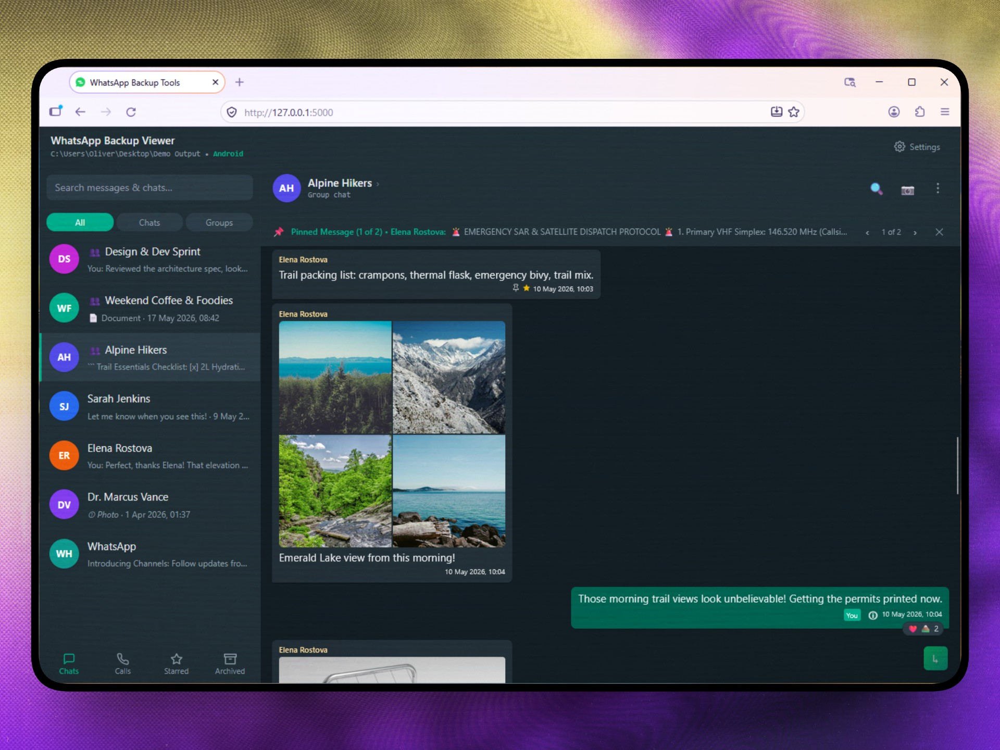
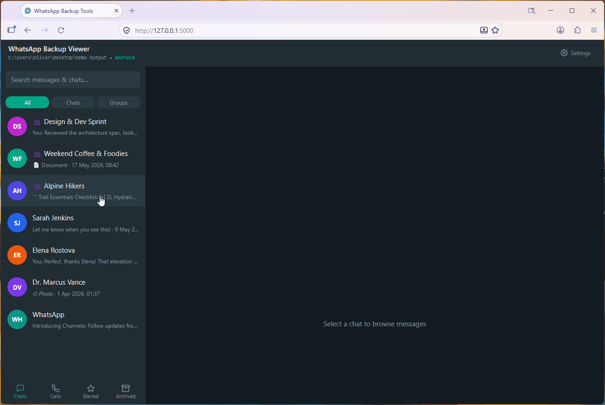

<p align="center">
  
</p>

<h1 align="center">WhatsApp Backup Tools</h1>

<p align="center">
  <strong>Your WhatsApp history, truly yours.</strong><br>
  The complete local-first suite to automatically organize your media and explore your chats offline, just like WhatsApp Web.
</p>

<p align="center">
  <a href="#features">Features</a> •
  <a href="#installation--quick-start">Quick Start</a> •
  <a href="#archive-structure">How It Works</a> •
  <a href="#known-limitations">Limitations</a>
</p>

<p align="center">
  <a href="https://pypi.org/project/whatsapp-backup-tools/"></a>
  <a href="https://github.com/auanasgheps/whatsapp-backup-tools/actions/workflows/tests.yml"></a>
  <a href="https://github.com/auanasgheps/whatsapp-backup-tools/tree/master/tests"></a>
  <a href="https://pypi.org/project/whatsapp-backup-tools/"></a>
  <a href="https://github.com/astral-sh/ruff"></a>
  <a href="https://github.com/auanasgheps/whatsapp-backup-tools/blob/master/LICENSE"></a>
</p>

<p align="center">
  
</p>

> **⚡️ 100% Local & Private** — No cloud accounts, no telemetry, no data leaves your machine. Full native support for **Android & iOS** backups on Windows, macOS, and Linux.

## Overview

WhatsApp Backup Tools is a suite to archive, manage, and access your WhatsApp data.
Consists of three complementary programs:

- **wab-archiver** (WhatsApp Backup Archiver) organises your WhatsApp media into a structured folder hierarchy using metadata from the WhatsApp database. Instead of an unstructured dump, you get a browsable archive sorted by contact or group, year, and direction (Sent/Received), with original message timestamps preserved.
- **wab-viewer** (WhatsApp Backup Viewer) lets you browse and search your archived chats through a local web UI, replicating WhatsApp Web.
- **wab-sweeper** (WhatsApp Backup Sweeper) safely reclaims storage on your phone by removing media that is already verified in your archive, with precision `restore` and `undo` support. _Android only_.

All tools run locally — **no data leaves your machine**. Windows, Linux, and macOS are supported. Python 3.11 required.

> ⚠️ **These tools are designed to run on a backup copy of your WhatsApp data — never on live device files.** The archiver always makes a copy of your data.

---

## Table of Contents

> **Ready to begin?** Skip directly to [Installation & Quick Start](#installation--quick-start).

- [Features](#features)
  - [WhatsApp Backup Archiver](#whatsapp-backup-archiver)
  - [WhatsApp Backup Viewer](#whatsapp-backup-viewer)
  - [WhatsApp Backup Sweeper](#whatsapp-backup-sweeper)
- [Archive Structure](#archive-structure)
- [Installation & Quick Start](#installation--quick-start)
  - [Step 1: Install the Tool](#step-1-install-the-tool)
  - [Step 2: Get the Files from Your Phone](#step-2-get-the-files-from-your-phone)
  - [Step 3: Archive & View](#step-3-archive--view)
  - [Step 4: Reclaim Phone Storage (Optional, Android)](#step-4-reclaim-phone-storage-optional-android)
- [Re-running the Archiver](#re-running-the-archiver)
- [Prerequisites](#prerequisites)
- [Known Limitations](#known-limitations)
- [Star History](#star-history)
- [Credits](#credits)
- [Development Philosophy](#development-philosophy)
- [Disclaimer](#disclaimer)

---

## Features

### WhatsApp Backup Archiver
Organise and preserve your WhatsApp media in a clean, human-readable structure.

#### 🗂️ Organization & Metadata Stamping
- **Structured & Human-Readable**: Organises media into `Contacts/` and `Groups/` sorted by year and `Sent/Received`, with original WhatsApp message timestamps preserved.
- **EXIF & Container Metadata Writing**: Optionally writes original WhatsApp message timestamps directly into image EXIF metadata and MP4/M4A video/audio headers so third-party photo managers (Google Photos, Immich, Apple Photos) index media on chronological timelines. Includes a dedicated `update-metadata` command to retroactively backfill existing archives in-place.
- **Supported Media**: Images, Videos, Audio, Voice notes, Video messages, Animated GIFs, Documents, Stickers, and Contact cards (.vcf).

#### ⚡ Ingestion & Incremental Merging
- **Android Incremental Backup Merging**: Discovers, decrypts, and sequentially merges Android incremental backups (`msgstore-increment*.db.crypt14/15`) with full entity resolution for reactions, polls, pins, locations, and edits.
- **Cross-Platform Extraction**: Works with both Android (no root required; USB ADB mode supported) and iOS (via local device backups), with optional restore mode to reconstruct Android media layouts.
- **Smart Identity Tracking**: Automatically detects contact renames, phone number migrations, and groups with identical names across runs.

#### 🛡️ Safety & Preservation
- **Deleted Message & Chat Preservation**: Seamlessly retains messages and chats deleted from your phone or revoked by senders across backup cycles (`-P`/`--preserve-deleted`), including call logs, interactive polls, shared locations, and progressive edit history.
- **Safe & Incremental Runs**: Skips identical files, never overwrites existing media, merges multiple backup roots (`--wa-root`), and exports duplicate, missing, and conflicting media CSV audit reports.

### WhatsApp Backup Viewer
Explore and search your archived chats through a local web UI replicating WhatsApp Web.

<p align="center">
  
</p>

#### 🖥️ WhatsApp Web Experience & Navigation
- **Authentic WhatsApp Web UI**: Fast, responsive layout with dark and light themes, contact avatars, customizable font size, and regional date formats. On phones, the chat list and the chat open as two levels like the WhatsApp app, with back navigation.
- **Multi-Language Interface**: Available in English, German, French, Italian, and Spanish, with automatic browser language detection and manual selection in **Settings**.
- **Dedicated Navigation Tabs**: Browse **Chats**, **Call History**, **Starred Bookmarks**, and **Archived Chats** from the sidebar, with tab-aware search and instant keyboard shortcuts (`Ctrl+K` / `/`).
- **Full-Text & Contextual Search**: Search across all chats or within a single conversation, jump directly to matches, or jump to specific dates with the date picker.

#### 💬 Rich Timeline & Interactive Messaging
- **In-Chat Call Bubbles**: Voice and video calls rendered chronologically in chat timelines with call duration, status, and 1-click jump to context.
- **Interactive WhatsApp Polls**: Native poll cards with option percentages, checkmarks, and an interactive "View votes" popup detailing voter identities.
- **Pinned Messages Banner Strip**: Authentic banner strip beneath the chat header to cycle through pinned messages and jump directly to them with emerald highlights.
- **Progressive Edit History**: Inspect original text and edit timestamps for modified messages.
- **Interactive Mentions & Sender Colors**: Group `@mentions` styled as badges opening 1-to-1 chats, with theme-adaptive participant sender colors.
- **Collapsible Long Messages**: Neatly trimmed long text and media captions with a "Read More" toggle.

#### 🎙️ Media, Voice Waveforms & Video Notes
- **Voice Message Waveforms**: Authentic sound waveforms with tap/drag scrubbing, adjustable playback speeds (`1x` to `2x`), and duration badges.
- **Circular Video Notes**: Signature circular push-to-video player with live countdown rings.
- **In-Browser Gallery & Lightbox**: Stream videos/audio, open photos in a full-screen lightbox with pan/zoom, and explore categorized media (photos, videos, audio, voice notes, documents, stickers).

#### 🛡️ Privacy & Flexible Deployment
- **100% Local & Offline**: All databases and assets run locally; no external network requests or analytics.
- **Sub-Path & Reverse Proxy Hosting**: Serve under custom base URLs (e.g. `/whatsapp`) behind Nginx, Traefik, or Caddy via `--base-path`.
- **External Storage Support**: Whitelisted symlinks and Windows NTFS Directory Junctions to keep heavy media folders on secondary hard drives.

### WhatsApp Backup Sweeper
Safely reclaim storage on your Android phone by removing media that has already been verified and archived.

- **4-Gate Integrity Pipeline**: Never deletes a file on your phone unless it is cataloged in `.wa_media_archiver.db`, physically present in your local archive, confirmed on the device, and passes MD5 content verification (EXIF-stamp aware).
- **Flexible Policies & Single-Chat Safety Handshake**: Filter by age, space quota (sorted by oldest or largest), minimum file size, media type, or target a single verified chat.
- **Built-in Protections**: Defaults to dry-run preview, requires typed confirmation before deleting, and protects starred messages, preserved/revoked media, shared cross-chat media, system folders, and active WhatsApp backups.
- **Precision Restore & Undo**: Push archived media back to your phone (`wab-sweeper restore`) or roll back the most recent sweep (`wab-sweeper undo --last`), restoring file permissions and original timestamps while tracking resumable state in `.wab-sweeper.db`.

---

## Archive Structure

After a successful run, the archive is organised into a clean, human-readable hierarchy:

```text
📁 <output>/
├── 👤 Contacts/
│   ├── John Doe (0039123456789)/
│   │   ├── 2023/
│   │   │   ├── 📥 Received/
│   │   │   └── 📤 Sent/
│   │   └── 2024/
│   │       ├── 📥 Received/
│   │       └── 📤 Sent/
│   └── Unknown (0044987654321)/
│       └── 2022/
│           └── 📥 Received/
├── 👥 Groups/
│   ├── Family Chat/
│   │   ├── 2023/
│   │   │   └── 🖼️ IMG-20230115-WA0001_JohnDoe.jpg
│   │   └── 2024/
│   │       └── 🎥 VID-20240115-WA0002_Me.mp4
│   └── Work Team/
│       └── 2024/
├── 🗄️ WhatsApp Databases/          # Decrypted ChatStorage.sqlite, msgstore.db, etc.
├── 🛡️ preserved_messages.db        # Deleted messages, polls & edits (when using -P)
├── ⚙️ .wa_media_archiver.db        # Archive cache & state tracking
├── 📝 wab-archiver.log             # Execution audit log
├── 📊 missing_media_report.csv     # Missing media report
├── 📊 duplicate_media_report.csv   # Deduplicated media audit
└── 📊 source_conflicts_report.csv  # Conflicting copies across backup roots (--wa-root)
```
*Please note: the actual output does not contain these emojis, they have been added here only for readability purposes.*


- Files in **Contacts** folders retain their original filename
- Files in **Groups** folders have the sender name appended: `IMG-20230115-WA0001_JohnDoe.jpg`
- Your own sent media in groups is appended with `_Me`
- All copied files have their **modified date set to the original WhatsApp timestamp** (optionally, embedded EXIF `DateTimeOriginal` and MP4 container metadata can also be written using `--exif-timestamps`)
- Contact folder names use the `00` prefix for phone numbers (e.g. `0039...`), not `+`

---

## Installation & Quick Start

To organize and view your WhatsApp data on your computer, the tool needs two things from your phone: your **WhatsApp Database** and your **WhatsApp Media**.

Everything is processed **100% locally on your computer** — no data leaves your machine. See [docs/prerequisites.md](docs/prerequisites.md) for full system requirements.

---

### Step 1: Install the Tool

Ensure **Python 3.11+** is installed, then install from PyPI:

```bash
pip install whatsapp-backup-tools
```

> 💡 **Windows users:** If `pip` is not recognized, run `py -m pip install whatsapp-backup-tools` instead.

<details>
<summary><b>Alternative installation methods (offline wheel, clone, or running without pip)</b></summary>

- **Pre-built wheel (.whl):** Download from [GitHub Releases](https://github.com/auanasgheps/whatsapp-backup-tools/releases) and run:
  ```bash
  pip install whatsapp_backup_tools-x.xx-py3-none-any.whl
  ```
- **Local clone:**
  ```bash
  git clone https://github.com/auanasgheps/whatsapp-backup-tools.git
  cd whatsapp-backup-tools
  pip install .
  ```
- **Manual execution without pip:**
  ```bash
  python -m wab_archiver --help
  python -m wab_viewer --help
  python -m wab_sweeper --help
  ```
</details>

---

### Step 2: Get the Files from Your Phone

Choose your platform for a step-by-step extraction walkthrough:

| 🤖 Android | 🍏 iOS / iPhone |
| :--- | :--- |
| **[Open Android Setup Guide →](docs/archiver/setup-android.md)** | **[Open iOS Setup Guide →](docs/archiver/setup-ios.md)** |
| • **E2E Encrypted Backup**: **Enabled** (save 64-digit key)<br>• **Media Sync**: Pull automatically over USB (`--from-adb`) or via Syncthing<br>• **Root**: *Not required* | • **In-App E2E Backup**: **Disabled**<br>• **Backup Source**: Local backup via Finder (macOS) or Apple Devices / iTunes (Windows)<br>• **Type**: *Standard unencrypted backup* |

---

### Step 3: Archive & View

The simplest and recommended way to archive your data is using a configuration file (`config.toml`), which avoids entering long terminal paths on every run.

#### 1. Generate & Fill Your Configuration
Generate a starter configuration template in your current folder:

```bash
wab-archiver config generate
```

Open `example-config.toml`, enter your settings (destination path, backup source, and encryption key or iOS backup path), and save it as `config.toml`. See the [Configuration Guide](docs/archiver/configuration.md) for full descriptions of all options.

#### 2. Run the Archiver
Run a preview (`--dry-run`) first to verify your configuration and paths:

```bash
wab-archiver archive --dry-run
```

Once the dry run completes without errors, remove `--dry-run` to create your archive:

```bash
wab-archiver archive
```

<details>
<summary><b>Prefer running directly via command line without a config file?</b></summary>

**Android example:**
```bash
wab-archiver archive \
  --msgstore "/path/to/WhatsApp/Databases/msgstore.db.crypt15" \
  --e2e-key YOUR_64_CHAR_KEY \
  --wa-root "/path/to/WhatsApp" \
  --output "/path/to/my-archive" \
  --dry-run
```
*(Alternatively, if your phone is connected via USB, use `--from-adb` to pull and decrypt the database automatically.)*

**iOS example:**
```bash
wab-archiver archive \
  --ios-backup "/path/to/Backup/<UDID>" \
  --output "/path/to/my-archive" \
  --dry-run
```

> 💡 On Windows, replace the line continuation `\` with `` ` `` (PowerShell) or `^` (cmd.exe). Remember to enclose paths containing spaces in quotes.
</details>

<details>
<summary><b>Already have an archive and only want to add EXIF timestamps?</b></summary>

To retroactively backfill original WhatsApp timestamps into your photos and videos without re-extracting:
```bash
wab-archiver update-metadata "/path/to/my-archive"
```
</details>

#### 3. Open the Local Chat Viewer
Point `wab-viewer` to your archive folder:

```bash
wab-viewer "/path/to/my-archive"
```

Open your browser at `http://127.0.0.1:5000` to browse, search, and relive your chats. See the [Viewer Guide](docs/viewer/index.md) for all features.

---

### Step 4: Reclaim Phone Storage (Optional, Android only)

Once your archive is verified, you can free up space on your Android device via ADB without losing your media. wab-sweeper always previews in dry-run mode first:

```bash
wab-sweeper init-config                          # Generate config.toml
wab-sweeper sweep --config config.toml           # Preview (dry-run)
wab-sweeper sweep --config config.toml --execute # Delete verified files
```

See the **[Sweeper Guide](docs/sweeper/index.md)** for single-chat targeting, `restore`, and `undo`.

---

## Re-running the Archiver

The archiver is **safe to re-run** on an existing archive:
- Files already copied with identical content will be **silently skipped**
- Files with the same name but different content will be **renamed with a numeric suffix** and logged as a warning
- New media not yet in the archive will be **copied normally**
- If a contact has been **renamed** since the last run, their folder on disk will be **automatically renamed** to match, keeping the archive consolidated
- Recommended: use the config file to keep settings for easier re-runs

---

## Prerequisites

- **Python 3.11** or later is required
- **Core Dependencies**: Required Python packages (`flask`, `wa-crypt-tools`, `iphone-backup-decrypt`, `cryptography`) are installed automatically by `pip`. See [docs/prerequisites.md](docs/prerequisites.md) for complete technical details.
- **Android**: 
  - End-to-end encrypted backup must be **enabled** in WhatsApp before pulling the database. Root is not required
  - ADB is installed
- **iOS/iPadOS**: 
  - End-to-end encrypted backup must be **disabled**
  - An iOS backup on your computer

See [docs/prerequisites.md](docs/prerequisites.md) for full setup instructions: E2E backup configuration, database extraction (Android and iOS), contacts pull, and locating your media folder.

---

## Known Limitations

### Archiver

- **iOS restore mode is not supported**: Restore mode reconstructs the Android `Media/` folder layout, which has no equivalent on iOS, also because Apple locks down app storage.
- **iOS number change tracking is best-effort**: Unlike Android, iOS backups do not record an explicit number-change table. Saved address book contacts with a single number change consolidate automatically; unsaved contacts or contacts with multiple number changes appear as separate folders.

### Viewer

- **Profile pictures are not displayed**: Local WhatsApp backups do not store contact avatars.
- **Unsaved contact push names on Android require root**: Friendly push names for unsaved numbers reside in private application storage (`wa.db`), excluded from backups. Unsaved numbers display their international phone number.
- **Recent Android link previews and media thumbnails may be missing until the next full backup**: To save space and mobile data, WhatsApp's daily incremental backups only save message text and details, leaving out image previews. Once WhatsApp completes its next full base backup on your phone (typically every 5 to 7 days, or when manually triggering a backup in WhatsApp settings), those missing previews will appear after updating your archive. Because this tool runs 100% locally and offline, it never connects to WhatsApp servers to download missing previews.
- See [viewer known limitations](docs/viewer/index.md#known-limitations) for full technical details on receipts and incremental preview caches.

### Sweeper

- **iOS is not supported**: Apple locks down app storage on iPhones and iPads, so external tools cannot delete or restore individual WhatsApp media files directly on the device. Because iOS backups on your computer are read-only snapshots rather than live phone storage, `wab-sweeper` only works with Android devices via ADB.

---

## Star History

<a href="https://www.star-history.com/?repos=auanasgheps%2Fwhatsapp-backup-tools&type=date&legend=top-left">
 <picture>
   <source media="(prefers-color-scheme: dark)" srcset="https://api.star-history.com/chart?repos=auanasgheps/whatsapp-backup-tools&type=date&theme=dark&legend=top-left" />
   <source media="(prefers-color-scheme: light)" srcset="https://api.star-history.com/chart?repos=auanasgheps/whatsapp-backup-tools&type=date&legend=top-left" />
   
 </picture>
</a>

---

## Credits and Thanks

- Inspired by [Wa_Immich_Tagger](https://github.com/mac12m99/Wa_Immich_Tagger) by mac12m99 — provided the initial Android DB query pattern
- iOS backup reading approach inspired by [whatsapp-chat-exporter](https://github.com/KnugiHK/whatsapp-chat-exporter) by KnugiHK
- Decryption powered by [wa-crypt-tools](https://github.com/eladnava/wa-crypt-tools) (Android) and [iphone-backup-decrypt](https://github.com/johanley/iphone-backup-decrypt) (iOS)
- WebUI styled with [Pico CSS](https://picocss.com/)
- Protobuf schema and wire tag definitions cross-referenced with [wa-proto](https://github.com/wppconnect-team/wa-proto) by WPPConnect and [Baileys](https://github.com/WhiskeySockets/Baileys) by WhiskeySockets

---

## Development Philosophy

Handling personal communication archives requires high standards for data integrity and privacy. This project is built on three core engineering pillars:

- **Strict Verification**: Over **1,000 unit, integration, and UI tests** validate everything from multi-root media deduplication to SQLite transaction safety.
- **Domain Rigor**: Deep reverse-engineering of proprietary WhatsApp artifacts across both mobile operating systems (cryptographic pipelines, protobuf varints, and auxiliary databases), cross-checked against established open-source implementations to ensure structural accuracy.
- **Developed with AI**: Modern AI coding tools were leveraged as pair programmers to accelerate implementation and broaden test coverage, strictly guided by human architectural design and verified against automated CI suites.

---

## Disclaimer

WhatsApp Backup Tools are not affiliated, associated, authorised, endorsed by, or in any way officially connected with WhatsApp LLC, or any of its subsidiaries or its affiliates.

The project is provided 'as is' without any express or implied warranties.
