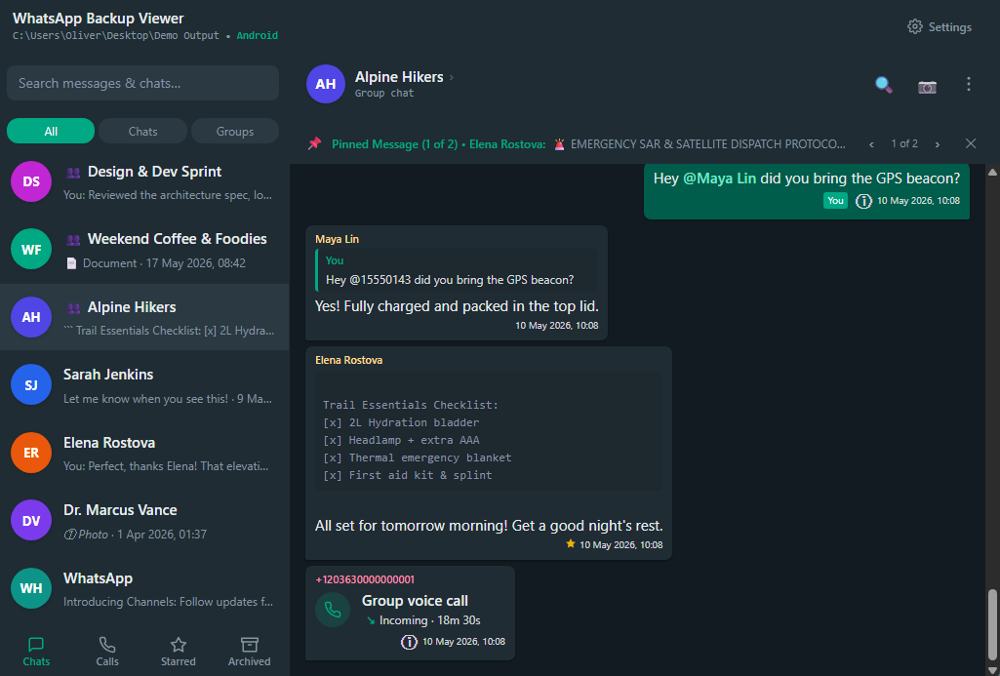
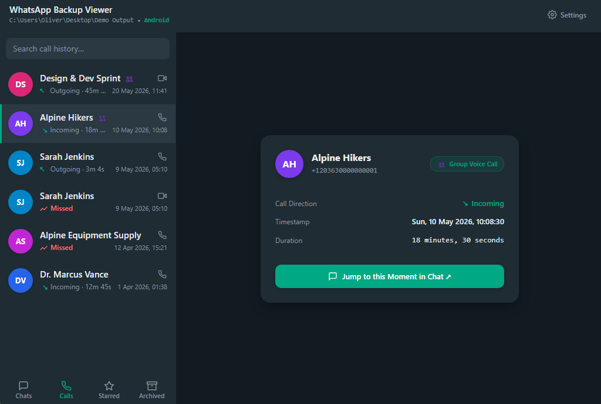
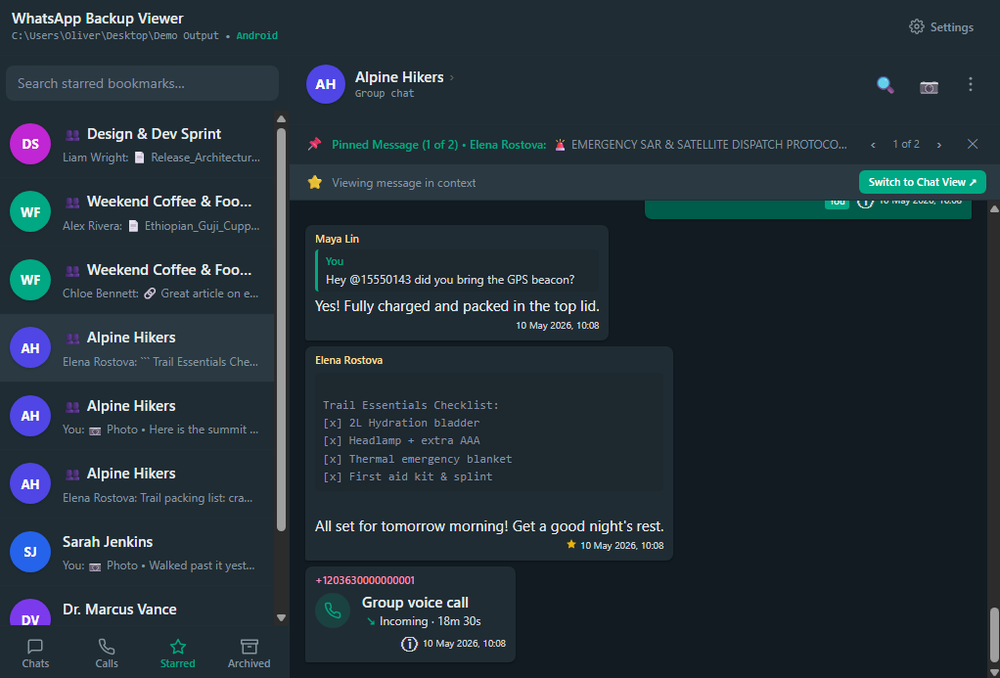
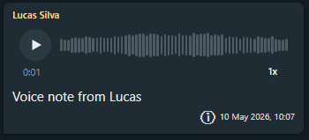

# WhatsApp Backup Tools v0.80

Version 0.80 brings major enhancements to _WhatsApp Backup Tools_, focusing on expanded Viewer features, interactive audio playback, media timestamping, and general UI/UX refinements.

Brace yourselves: This update introduces many new features!

Call History, Archived chats, Starred bookmarks, the ability to see pinned messages, interactive group `@mentions` with 1-to-1 chat links, collapsible long messages, circular video notes, voice message waveforms, retroactively backfillable photo and video timestamps, and theme-adaptive group sender colors.

We have reached parity with major WhatsApp features, and work continues on minor features.

Also thanks to the first external contributors, @pablobeaus and @Piero-93!


#### **Release highlights:**


> 🖥️ **New Look and feel**:
> The UI/UX of the Viewer has been significantly expanded. Introducing chats avatars, navigation menu for Chats, Calls, Starred Messages and Archived Messages. A new chat submenu has been added to not clutter the chat bar.  


> 📞 **Call History**:
> Browse your complete voice and video call logs directly within the viewer. A new Call side pane displays caller information, durations, and participants, with a "Jump to this Moment in Chat" button that brings you straight to that exact point in time. Calls are also displayed directly into chat timelines as chronological call bubbles.


> ⭐ **Starred Messages & Bookmarks**:
> Quickly view your saved and starred messages from the dedicated Starred tab or from an in-chat slide-out panel. Tapping any starred message jumps straight to that message in the conversation with a glowing golden highlight.


> 🎙️ **Voice Message Waveforms & Audio Player**:
> Voice notes now look and feel authentic with interactive sound waveforms, adjustable playback speeds (1x to 2x), and a circular play/pause button. Tap or drag anywhere on the waveform to scrub forward and backward.


> 🏷️ **Photo & Video Timestamp Embedding**:
> Save original WhatsApp message dates directly into your photos and videos (`--exif-timestamps`), or update existing archives with the new `wab-archiver update-metadata` command. Cloud photo apps like Google Photos, Apple Photos, and Immich will now organize your archived media in the correct order.

> 📌 **Pinned Messages Banner Strip**:
> Conversations with pinned messages now show an authentic banner strip beneath the chat header. Flip through multiple pins, dismiss the banner for your session, or jump straight to any pinned message with an emerald highlight.

> 👥 **Interactive Group Mentions**:
> Mentions in group chats (`@Alice`, `@Bob`) are now recognized and styled as badges. Clicking a mention opens your 1-to-1 conversation with that person if an archived chat exists.

> 📜 **Collapsible Long Messages & Circular Video Notes**:
> Long text messages and photo captions are neatly trimmed with a simple "Read More" button to keep your timeline readable. Quick video notes also play in their signature circular player with live countdown rings.

> ⚡ **Supercharged Chat & Gallery Loading**:
> Conversations with hundreds of thousands of messages now open at least 3 times faster, while the Gallery loads much faster as well. 
---

### 📁 WhatsApp Archiver

#### ✨ New Features
- **EXIF & Video Timestamp Embedding**: Embed WhatsApp message dates directly into your saved photos and videos (via `--exif-timestamps` or in your configuration). Cloud gallery apps like Google Photos, Apple Photos, and Immich can now organize your media chronologically. Your original camera capture details and photo orientations are safely preserved.
- **Retroactive EXIF & Timestamp Backfill (`update-metadata`)**: Update timestamps on previously saved photos and videos at any time with the new `wab-archiver update-metadata` command. It works directly with your existing archive without needing a phone or backup connection, automatically skips files that were already updated, and ensures Windows file dates match the original messages.
- **Group Mention Preservation**: Group `@mentions` are now preserved across backup extractions and incremental updates, keeping participant mentions intact even if messages were removed from your phone.
- **iOS Call History Archiving**: Automatically discovers and archives your WhatsApp voice and video call logs from iPhone backups so you can explore them in the viewer.

#### ⚡ Improvements
- **Faster Incremental Checks & Audio Container Support**: Smarter, faster checks when archiving new media avoid accidental file renames and add timestamp embedding support for `.m4a` audio recordings.
- **Modular Automated Test Suite**: Reorganized the automated test suite into modular, component-focused suites with fast category markers, speeding up testing and ensuring maximum reliability across backup extractions and incremental merges.
- **Android Mention Tracking in Incremental Backups**: Captures and tracks group mentions from incremental Android backup files when merging them into your archive.

#### 🐛 Bug Fixes
- **Collision-Renamed Media Retention**: Fixed an issue where media files that had received collision suffixes (e.g. `_1.jpg`) during earlier runs were unnecessarily re-copied on subsequent incremental runs. (#14 by by @Piero-93)

---

### 🌐 WhatsApp Viewer

#### ✨ New Features
- **Archived Chats Tab & Navigation**: A dedicated "Archived" tab in the bottom navigation bar lets you browse archived conversations separately from your active inbox, with tab-aware search and instant chat opening.
- **Audio & Voice Note Gallery Cards**: Voice notes and music tracks are now neatly separated in the Media Gallery with custom cards, duration badges, clean titles, counts, and a built-in audio player.
- **Avatars in Chat List & Starred Views**: Circular contact avatars with generated initials and distinct colors now appear in active and archived chat lists as well as starred message previews, matching call list styling.
- **Call History & Call Inspector**: Browse your complete voice and video call logs with dedicated filters (All, Missed, Video), two-line call cards, and a detailed Call Inspector side pane. A "Jump to this Moment in Chat" button navigates directly to the conversation at the time of the call.
- **Chat Header Overflow Menu**: A clean 3-dot dropdown menu in the chat header neatly tucks away secondary actions (Media Gallery, Starred Messages, Chat Info), keeping the conversation bar uncluttered.
- **Circular Video Note Player**: Quick video notes now play in an authentic circular bubble with an animated countdown ring, fullscreen viewing, and automatic pausing when you scroll past.
- **Collapsible Long Messages & Media Captions**: Long text messages and photo captions are neatly trimmed with an easy "Read More" / "Show Less" toggle, keeping your chat timeline clean and readable while preserving formatting and emojis.
- **Group Sender Name Colors**: Group chat participants now receive distinctive, theme-adaptive sender name colors (matching WhatsApp's palette) across dark and light modes, applied to message headers and quoted reply borders.
- **Group `@mentions` with 1-to-1 Chat Links**: Mentions in group chats are highlighted as interactive badges. Clicking a mention smoothly opens your 1-to-1 chat with that person if an archived conversation exists.
- **In-Chat Chronological Call Bubbles**: Voice and video calls are seamlessly woven directly into chat timelines as chronological call bubbles, showing call outcome, duration, and details at a glance.
- **Lightbox Smooth Slide Transitions**: Browsing photos and videos in full screen is now much smoother, featuring seamless slide animations, instant image pre-loading, improved zoom and pan controls, and automatic skipping of unavailable files.
- **Phone Number & Group Description Search**: Searching conversations in the sidebar now matches formatted phone numbers and group descriptions alongside contact and group names.
- **Pinned Messages Banner Strip & Jump**: Important conversations with pinned messages display an authentic banner strip beneath the chat header. Flip through multiple pins, dismiss the banner for your session, or jump straight to any pinned message with an emerald highlight.
- **Reverse Proxy & Sub-Path Hosting**: You can now host the viewer under a custom URL prefix (e.g. `https://my-server.local/whatsapp/`) behind reverse proxies like Nginx, Traefik, or Caddy using `--base-path /whatsapp` or the `WAB_BASE_PATH` environment variable. (#17 by @Piero-93)
- **Starred Messages & Drawer**: Starred messages can be browsed globally via the sidebar "Starred" tab or per-chat via the header slide-out drawer, with a 1-click jump to context.
- **Tab-Aware Search & Universal Shortcuts**: The search bar dynamically adapts to your active navigation tab—searching messages, call history, starred bookmarks, or archived chats—with instant `Ctrl+K` (or `/`) keyboard shortcuts.
- **Voice Message Waveforms & Authentic Player**: Voice notes now look and feel like native WhatsApp messages, featuring interactive sound waveforms you can tap or drag to scrub through, adjustable playback speeds (`1x`, `1.2x`, `1.5x`, `2x`), and duration counters.
- **Android Calls & Starred Identity Resolution**: Matches privacy identifiers in Android call logs and starred messages to actual contact names and phone numbers, ensuring direct links open the right conversation.
- **iOS Call History & Contact Linking**: Accurately connects call participants, outcomes (incoming, outgoing, missed), and conversation links from iPhone backup records.
- **iOS Legacy Emoji Conversion**: Converts vintage emoji from early iPhone backups (pre-2015 private-use characters) into modern Unicode emoji so they display properly in messages instead of broken rectangles. (#18 by @Piero-93)

#### ⚡ Improvements
- **Accelerated Chat Loading for Massive Conversations**: Opening large chats with tens or hundreds of thousands of messages is now many times faster.
- **Captioned Media Containment & Sizing**: Photos and videos with captions now fit together naturally without awkward extra space or stretched bubbles, nicely framing portrait and landscape media.
- **Chat Duration & System Message Exclusion**: System notices (such as encryption alerts or group creation notices) are no longer counted toward conversation start dates and chat durations, giving you a true reflection of when you actually talked.
- **Display Scale Settings**: Adjust the entire viewer interface with a new "Display scale" setting to comfortably size text, sidebars, and media for your screen.
- **Dual-Theming & Contrast Polish**: Refined colors, better contrast, and subtle shadows across both light and dark modes make messages easier to read in any lighting.
- **External Media Storage Support**: You can now store your heavy media folders (`Contacts/` and `Groups/`) on a separate hard drive or external disk and link them into your archive (using symlinks on Linux/macOS or Directory Junctions on Windows). Photos, videos, and audio open and stream at full size while keeping your files safe and secure. (co-authored by @Piero-93)
- **In-Bubble Star & Pin Indicators**: Subtle star (`⭐`) and pin (`📌`) icons sit neatly next to the message time, keeping message cards compact and uncluttered.
- **Media Gallery Centered Loading & Navigation**: Opening the media gallery is now smoother, featuring centered loading indicators, seamless chat switching without glitches, and fast preview loading for shared links as you scroll.
- **Media Gallery Filtering & High-Speed Loading**: The media gallery is significantly faster and easier to explore. You can now view photos and videos together or filter down to specific categories (Photos, Videos, Voice notes, Audio, Documents, Links, Stickers, and Contacts) with instant visual updates, smooth scrolling, and helpful end-of-results notices.
- **Modernized UI Shell & Navigation Bar**: A refreshed navigation bar with four clear tabs (Chats, Calls, Starred, Archived), an updated header, and full keyboard navigation support.
- **Modular Backend Architecture**: Reorganized the viewer backend into dedicated domain modules and query handlers, improving system stability, memory isolation, and overall responsiveness across large archives.
- **Modular Frontend & Zero-Build Stylesheet Delivery**: Reorganized the viewer's interface styles and scripts into clean, component-focused modules assembled directly in memory. This eliminates monolithic asset files, ensures consistent layout behavior, and delivers instant, zero-latency stylesheet loading without external build tools.
- **Rich Media Cards in Starred & Pinned Views**: Starred and pinned previews now show rich visual snippets—such as photo thumbnails, video lengths, voice note badges, and document icons—rather than plain text placeholders.
- **Thumbnail Shimmer Loading**: Video bubbles and media gallery cards display a smooth loading shimmer animation while full thumbnails are being generated or loaded in the background.
- **Time Gap Jump Indicators**: When jumping to a moment from call history or a starred message, a helpful banner tells you how far apart the nearest message was if no messages were sent on that exact day.
- **iOS High-Performance Message Scrolling**: Significantly faster timeline scrolling and instant message loading for large group chats from iPhone backups.

#### 🐛 Bug Fixes
- **Animated GIF & Video First-Frame Previews**: WhatsApp animated GIFs and video bubbles now immediately display their authentic first frame instead of a solid black box before playback.
- **Chat Missing Media Placeholders**: If a photo or video cannot be found on disk, the chat now displays a clean placeholder card with a blurred preview and the file size, rather than a broken image icon.
- **Contact Card Missing Status**: Shared contact cards are no longer incorrectly flagged as missing media since their contact details are stored directly in your messages.
- **Document Gallery Count**: Fixed an issue where certain documents were counted twice in the media gallery total.
- **Gallery All-Media View Switch**: When switching from the default photos and videos view to all media types in the gallery, all newly revealed items (like audio, documents, and stickers) now immediately appear in your view without needing to scroll down first.
- **Gallery Archive Year Counts**: Yearly totals in the Media Gallery Archive view now stay accurate and display correct item counts even before expanding past years.
- **Gallery Filter Cross-Category Isolation**: Fixed a visual issue where voice notes, audio files, or links would occasionally remain visible after selecting the Photos or Videos filter.
- **Gallery Loading in Non-Photo Chats**: Opening the Media Gallery in conversations that only contain links, documents, voice notes, or text now immediately switches to the first available category instead of staying stuck on "Checking media...".
- **Gallery Sparse Grid Packing**: Fixed an issue where viewing a single audio track or document in the gallery pushed the card down toward the bottom of the window.
- **Grouped Media Caption Visibility**: Captions on multi-photo albums from iPhone backups now display correctly on the grouped album card.
- **Location Pin Gallery Display**: Location shares no longer appear as broken files in the media gallery.
- **Long Message Emoji Truncation**: Fixed an issue where truncating long messages could cut complex emojis (like flags or family icons) in half.
- **Media Gallery Audio Errors**: Fixed an error when playing audio in the media gallery or jumping into chat from a voice note.
- **Quote Jump Auto-Expansion**: Clicking a quoted reply that refers to a collapsed long message now automatically expands it so you can read the full context.
- **Thumbnail Cache Reliability**: Improved thumbnail caching so missing preview lookups reset properly across viewer sessions.
- **iOS Location Message Chat List Crash**: Fixed an issue where an iPhone conversation whose latest message was a shared location caused the chat list to fail to load (#13 by @pablobeaus).

---

### 🚀 How to Upgrade

Update to the latest version using pip:

```bash
pip install --upgrade whatsapp-backup-tools
```

> 💡 **Windows users:** If `pip` is not recognized, run `py -m pip install --upgrade whatsapp-backup-tools` instead.
