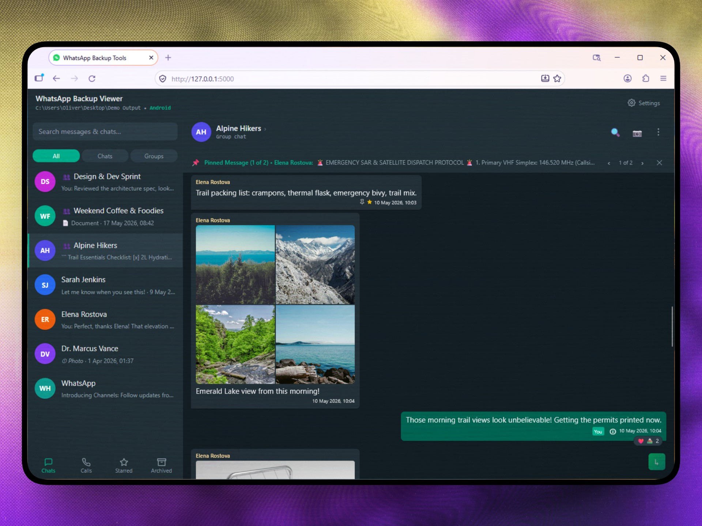
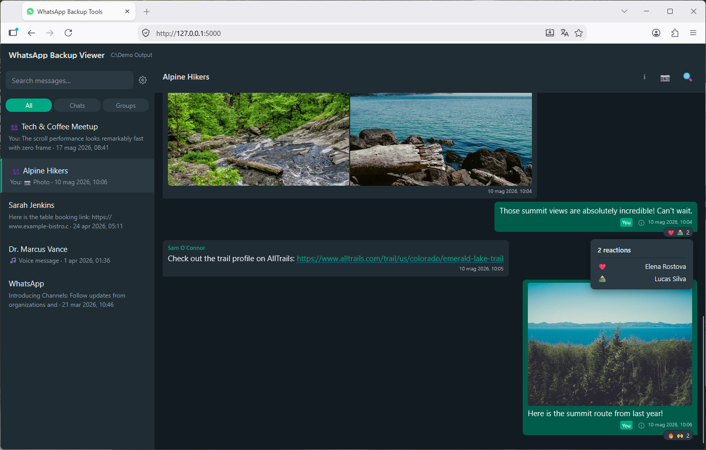
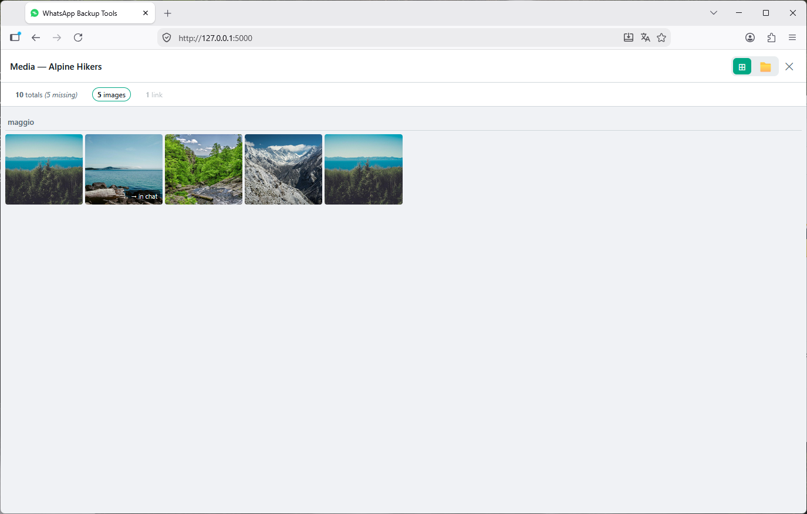

[← Back to Main Readme](../../README.md) • [Archiver Guide](../archiver/index.md) • [Sweeper Guide](../sweeper/index.md)

# WhatsApp Backup Viewer (`wab-viewer`)

Browse and search your archived WhatsApp chats offline through a local web UI replicating WhatsApp Web.

**WhatsApp Backup Viewer screenshots**

<p float="left">
  
</p>
<p float="left">
  
   
</p>

## Quick Start

Point `wab-viewer` to your archive output folder:

```bash
wab-viewer /path/to/archive
```

The viewer opens your browser at `http://127.0.0.1:5000`. Use `--rescan` to force a cache rebuild.

```bash
# Example
wab-viewer ./output

# Custom port
wab-viewer ./output --port 8080

# Expose on the local network (accessible from other devices)
wab-viewer ./output --host 0.0.0.0

# Start server without opening a browser (e.g. headless or remote machine)
wab-viewer ./output --no-browser

# Rebuild the cache
wab-viewer ./output --rescan

# Serve under a sub-path behind a reverse proxy (also via WAB_BASE_PATH)
wab-viewer ./output --base-path /whatsapp

# Enable verbose HTTP request logging (default is error only)
wab-viewer ./output --verbose

# Check the installed version
wab-viewer --version
```

By default, routine HTTP request logs (`GET /api/... 200`) are silenced to keep the console clean and focused on startup, cache, and error messages. Pass `--verbose` (or `-v`) to enable HTTP request logging for debugging.

## How It Works

On first run (or with `--rescan`), the viewer builds a local cache database (`.wa_viewer.db`) combining:

1. **Source WhatsApp database** (`msgstore.db` for Android, `ChatStorage.sqlite` for iOS) — timestamps, sender names, and text message bodies
2. **Archive database** (`.wa_media_archiver.db`) — maps original media paths to archived file locations
3. **Preserved messages database** (`preserved_messages.db`, optional) — retains messages deleted or revoked from the device when archived with `-P`

The source WhatsApp database (`msgstore.db` or `ChatStorage.sqlite`) is strictly required in `Whatsapp Databases/` (or directly in the archive root) for the viewer to launch and resolve chat messages and media paths.

### Storing Media on External Storage (Symlinks & Junctions)

If you have a large archive and prefer to keep heavy media folders (`Contacts/` and `Groups/`) on an external drive or secondary disk while keeping database files on your main drive, you can link them into your archive folder:

- **Linux & macOS (Symbolic Links)**:
  ```bash
  ln -s /path/to/external/Contacts /path/to/archive/Contacts
  ln -s /path/to/external/Groups /path/to/archive/Groups
  ```
- **Windows (NTFS Directory Junctions - no admin rights required)**:
  ```cmd
  mklink /J "C:\path\to\archive\Contacts" "D:\WhatsApp\Contacts"
  mklink /J "C:\path\to\archive\Groups" "D:\WhatsApp\Groups"
  ```

`wab-viewer` automatically recognizes whitelisted `Contacts/` and `Groups/` links and serves full-size photos, videos, and audio securely from external storage.

## Features

### 🖥️ WhatsApp Web Experience & Navigation
- **Authentic WhatsApp Web UI**: Fast, responsive layout with dark and light themes, contact avatars with generated initials, customizable display scale, and regional date formats.
- **Multi-Language Interface**: Available in English, German, French, Italian, and Spanish. Automatically detects your browser language (`Auto`) or can be switched anytime in **Settings**.
- **Dedicated Navigation Tabs**: Browse **Chats**, **Call History**, **Starred Bookmarks**, and **Archived Chats** from the sidebar bar.
- **Two-Level Phone Layout**: On narrow screens ($\le 600\text{px}$), the chat list and detail conversation open as two responsive levels like the WhatsApp mobile app, with header back navigation and support for native swipe gestures.
- **Chat Header Overflow Menu**: A clean 3-dot dropdown menu in the conversation header tucks away secondary actions (Media Gallery, Starred Messages drawer, Chat Info), keeping the chat bar uncluttered.

### 💬 Rich Timeline & Interactive Messaging
- **In-Chat Call Bubbles**: Voice and video calls rendered chronologically in chat timelines with outcome, duration, and metadata popovers.
- **Dedicated Call History & Call Inspector**: Full-featured call log browser with call type filters (All, Missed, Video), two-line call cards, detailed Call Inspector side pane, and a "Jump to this Moment in Chat" button.
- **Starred Messages & Bookmarks Drawer**: Browse starred messages globally in the sidebar or per-chat in a slide-out drawer, with 1-click context jumping and a golden halo highlight animation.
- **Pinned Messages Banner Strip**: Authentic banner strip beneath the chat header to cycle through pinned messages (`1 of N`) and jump directly to them with an emerald highlight.
- **Interactive WhatsApp Polls**: Native poll cards with proportional vote bars, percentages, checkmarks, and an interactive "View votes" popup detailing voter identities (Android & iOS).
- **Group `@mentions` with 1-to-1 Chat Links**: Mentions in group chats styled as interactive badges opening direct 1-to-1 conversations.
- **Theme-Adaptive Group Sender Colors**: 10-color high-contrast participant palettes for group sender headers and quoted reply borders across dark and light themes.
- **Progressive Edit History**: Modified messages retain their pre-edited draft; click the "Edited" badge or "ⓘ" message details button to inspect original text and edit timestamps.
- **Collapsible Long Messages & Media Captions**: Long text and photo captions are trimmed with an accessible "Read More" / "Show Less" toggle, preserving formatting and complex emojis.
- **Revoked & View-Once Badges**: Native tombstones ("This message was deleted") and status pills ("① Photo · Opened") for ephemeral and revoked media.
- **Shared Location Cards**: Location pins render with venue names, addresses, and direct Google Maps links.
- **Interactive Reply Jumping**: Reply bubbles jump to original quoted messages with highlight pulse and auto-expansion of collapsed quotes.

### 🎙️ Media, Waveforms & Video Notes
- **Voice Message Waveforms & Audio Player**: Interactive 64-bar sound waveforms with tap/drag scrubbing, adjustable playback speeds (`1x`, `1.2x`, `1.5x`, `2x`), and duration counters (Android amplitude extraction and iOS client-side Web Audio API).
- **Circular Video Notes (Push-to-Video)**: Round video messages render in authentic circular bubbles with duration rings, play/pause controls, fullscreen viewing, and viewport-aware pausing.
- **In-Browser Gallery & Lightbox**: Full-screen photo/video lightbox with smooth slide transitions, image pre-loading, pan, and zoom. Categorized media browsing across Photos, Videos, Voice notes, Audio, Documents, Links, Stickers, and Contact cards (.vcf).
- **Dynamic Missing Media Placeholders**: When media is absent from disk, styled placeholder cards (`.media-missing-card`) display blurred thumbnail previews extracted from database blobs.
- **Audio & Voice Note Differentiation**: Voice notes (PTT) and audio tracks are differentiated with dedicated gallery cards, duration badges, and built-in inline audio playback.
- **Media Streaming**: Videos and audio stream directly with HTTP Range support and video seeking; animated GIFs loop cleanly with click-to-play controls.

### 🔍 Search & Keyboard Shortcuts
- **Tab-Aware Universal Search**: Seamlessly adapts to the active tab—server-side full-text search across message bodies on Chats, or instant filtering across Call History, Starred messages, and Archived chats. Matches formatted phone numbers and group descriptions.
- **Global Keyboard Shortcuts**: Instant focus via `/` or `Ctrl+K` / `Cmd+K`, and layered `Escape` dismissal for lightboxes, drawers, and panels.

### 🛡️ Privacy, Storage & Deployment
- **100% Local & Offline**: All databases and assets run locally; no external network requests or analytics.
- **Sub-Path & Reverse Proxy Hosting**: Serve under custom base URLs (e.g. `/whatsapp`) behind Nginx, Traefik, or Caddy via `--base-path` or `WAB_BASE_PATH`.
- **External Storage Support**: Seamlessly serves media folders (`Contacts/` and `Groups/`) placed on external drives via Linux/macOS symlinks or Windows NTFS Directory Junctions.
- **Preserved Messages & Chats**: Retains and badges messages deleted from device ("Delete for Me"), sender-revoked messages ("Delete for Everyone"), and deleted chats when archived with `-P` / `--preserve-deleted`.

## Cache Invalidation

The cache database (`.wa_viewer.db`) is rebuilt automatically when:

- You pass `--rescan` on startup
- The source WhatsApp database (`msgstore.db` or `ChatStorage.sqlite`) has changed (detected via file modification timestamp, file size, or inode)
- An internal viewer database schema upgrade occurs

## Privacy & Network Access

The server binds to `127.0.0.1` by default — it is not accessible from other machines on your network. No data leaves your machine. To access the viewer from another device on your LAN, pass `--host 0.0.0.0` (make sure your firewall allows the port).

### Reverse Proxy & Sub-Path Hosting

When hosting the viewer behind a reverse proxy (such as Nginx, Traefik, or Caddy) under a sub-path (for example, `https://my-server.local/whatsapp/`), specify the URL prefix using `--base-path` or the `WAB_BASE_PATH` environment variable:

```bash
# Via command-line argument
wab-viewer ./output --base-path /whatsapp

# Or via environment variable
export WAB_BASE_PATH=/whatsapp
wab-viewer ./output
```

The viewer's WSGI middleware adapts `SCRIPT_NAME` and `PATH_INFO` automatically, so your reverse proxy can either forward the path prefix as-is or strip it before proxying.

#### Example Nginx Configuration

```nginx
location /whatsapp/ {
    proxy_pass http://127.0.0.1:5000/;
    proxy_set_header Host $host;
    proxy_set_header X-Real-IP $remote_addr;
    proxy_set_header X-Forwarded-For $proxy_add_x_forwarded_for;
    proxy_set_header X-Forwarded-Proto $scheme;
}
```

#### Example Caddy Configuration

```caddy
handle_path /whatsapp/* {
    reverse_proxy 127.0.0.1:5000
}
```

> ⚠️ **Security Notice**: `wab-viewer` does not include built-in user authentication. When exposing the viewer over your local network or via a reverse proxy, ensure access is restricted (e.g. using HTTP Basic Auth, Authelia, Authentik, Cloudflare Access, or a VPN).

## Troubleshooting

**No chats appear in the sidebar**

- Verify `msgstore.db` (Android) or `ChatStorage.sqlite` (iOS) is in the `Whatsapp Databases` subfolder (or directly in the output directory) alongside `.wa_media_archiver.db`
- Run with `--rescan` to force a cache rebuild and check the console output for warnings

**Media files return 404**

- The source WA database must be present in the archive directory (`Whatsapp Databases/` or root) for the viewer to resolve `archive_path` from `original_path`
- Verify that the archived media files have not been moved or renamed after archiving

**Text messages are missing**

- Ensure you have not excluded message tables or run with a corrupted WhatsApp database. The viewer requires a valid `msgstore.db` or `ChatStorage.sqlite` to load messages.

## Known Limitations

- **Profile pictures are not displayed.** On Android this requires extracting `wa.db` (not yet implemented). On iOS no local image data is available in the backup.
- **Friendly profile push names for unsaved contacts are not available on Android without root.** On Android, user-chosen friendly push names (`wa_name`) reside exclusively in `/data/data/com.whatsapp/databases/wa.db` within WhatsApp's private application sandbox. WhatsApp excludes contact records from local backups (`WhatsApp/Backups/wa.db.crypt14/15`), so extracting `wa.db` requires root access on the device, which is not implemented in the Viewer or Archiver. Unsaved contacts on Android will therefore display their phone number. On iOS, WhatsApp stores push names directly in `ChatStorage.sqlite` (`ZWAPROFILEPUSHNAME`), so they are preserved in standard backups.
- **iOS read and played receipts require `MessagingInfraDatabase.sqlite`.** On modern iOS backups (v2.24+), delivery, read, and voice message played timestamps are read directly from `MessagingInfraDatabase.sqlite`. For older backups or messages not recorded in it (such as those sent via web or companion devices), the viewer falls back to `ChatStorage.sqlite`'s `ZRECEIPTINFO`, which shows "Read (time not stored)" when a read state is confirmed without a timestamp.
- **Recent Android link and media previews**: If messages were imported from WhatsApp's daily incremental backups, link previews and quoted media thumbnails will not show an image preview yet. WhatsApp omits image previews from these small updates to save mobile data. They will appear automatically once WhatsApp runs its next full base backup on your phone (typically created every 5 to 7 days, or via a manual backup in WhatsApp settings) and you update your archive, as the viewer operates completely offline and never connects to the internet to download missing files.

---

## Navigation

- **Previous**: [Archiver Guide & Workflow](../archiver/index.md)
- **Next**: [Sweeper Guide (`wab-sweeper`)](../sweeper/index.md)
- **Home**: [Main Project Readme](../../README.md)

